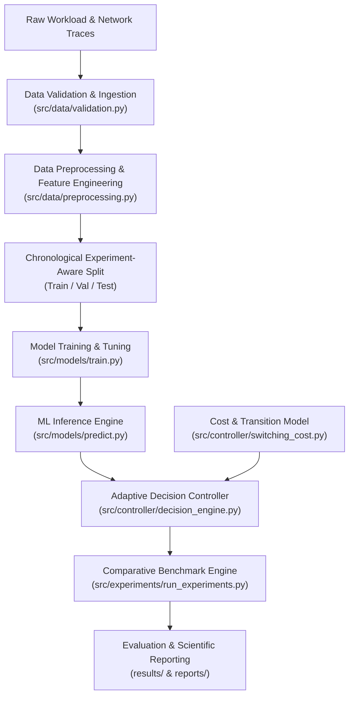

# Research Methodology

## Project Title
**Predictive Network- and Contention-Aware Concurrency Control Switching with Switching-Cost Optimization in Distributed Databases**

---

## 1. Research Question & Hypotheses
In distributed transaction processing systems, transaction contention (data item conflicts) and network conditions (latency, jitter, packet loss) fluctuate dynamically. Traditional systems deploy static concurrency control protocols (such as purely Optimistic Concurrency Control, Two-Phase Locking, or Multi-Version Concurrency Control) or naive reactive threshold-based heuristics.

### Central Research Question
> *Can predicting network and workload changes together, while explicitly accounting for protocol-switching costs and hysteresis, improve transaction performance (throughput, latency, aborts) and operational stability compared with static and reactive approaches?*

### Formal Hypotheses
1. **$H_1$ (Predictive Advantage):** Proactive protocol selection driven by machine learning predictions of future conflict rates and network RTT reduces the overall transaction abort rate and tail latency compared to static single-protocol configurations under non-stationary workloads.
2. **$H_2$ (Switching-Cost Amortization):** Explicitly optimizing for protocol transition costs and applying minimum interval hysteresis prevents system thrashing (excessive switching frequency), achieving superior net throughput compared to reactive threshold switching.

---

## 2. Theoretical Framework of Protocols
Concurrency control protocols exhibit distinct trade-offs across contention and network dimensions:

| Protocol | Low Contention + Low Latency | High Contention + Low Latency | High Network Latency / Jitter | Switching Considerations |
| :--- | :--- | :--- | :--- | :--- |
| **OCC** (Optimistic) | **Optimal**: Zero lock overhead, high throughput. | **Poor**: High validation failures and abort cascades. | **Moderate**: Validation delays prolong transaction life, increasing abort windows. | Low state barrier when switching to MVCC; higher when switching to lock-based 2PL. |
| **2PL** (Pessimistic) | **Sub-optimal**: Unnecessary lock management overhead. | **Optimal**: Prevents conflicting transactions early; eliminates validation aborts. | **Poor**: Lock-holding times balloon with network RTT, leading to convoy effects and deadlocks. | Requires clearing lock tables and resolving in-flight active locks. |
| **MVCC** (Multi-Version) | **High**: Non-blocking reads from snapshot versions. | **Robust**: Writes conflict, but reads never block writes; excellent for mixed workloads. | **Robust**: Read transactions remain immune to coordinator network delays. | Requires managing undo/version chains and garbage collection state during transition. |

---

## 3. Methodological Pipeline Architecture

---

## 4. Experimental Strategies Compared
1. **Static Baseline:**
   - Evaluates pure OCC, pure 2PL, and pure MVCC across all workload scenarios without any switching.
2. **Reactive Controller:**
   - Evaluates instantaneous metrics against static thresholds. Switches immediately when a threshold is crossed, subject only to basic interval boundaries.
3. **Predictive Controller (Proposed):**
   - Ingests rolling multi-step lag features.
   - Infers expected conflict rate $\hat{C}_{t+h}$ and network RTT $\hat{R}_{t+h}$ for horizon $h$.
   - Calculates net suitability delta $\Delta S = S_{\text{target}} - S_{\text{current}} - \text{CostPenalty}$.
   - Only triggers a switch when $\Delta S > \theta_{\text{improvement}}$ and minimum switching interval has elapsed.

